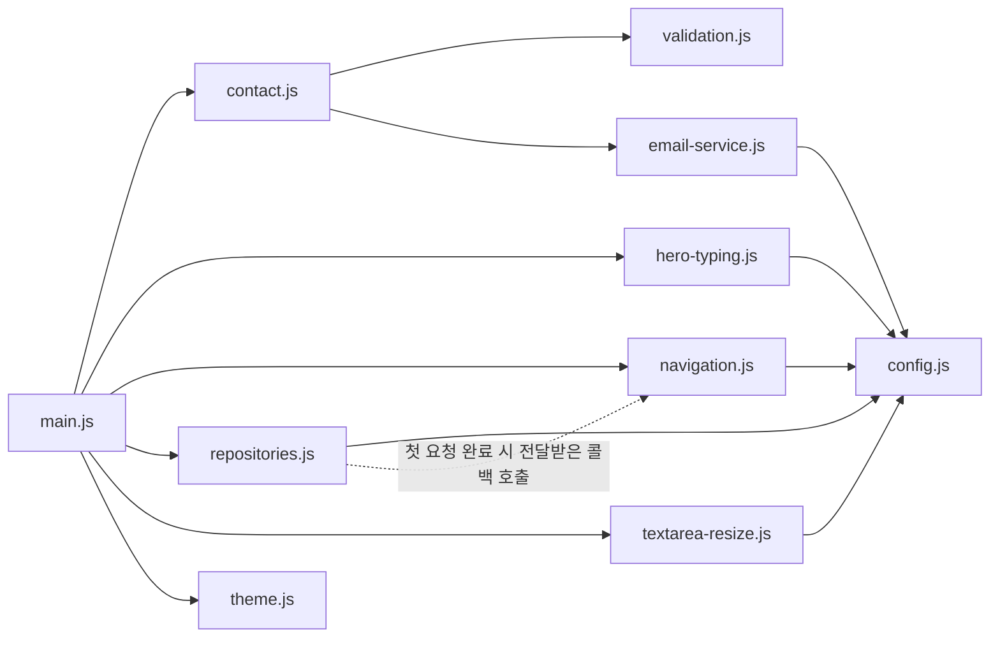

# B4-1 Portfolio

모바일 우선으로 만든 학습용 개인 포트폴리오입니다. 별도 빌드 과정이나 외부 런타임 라이브러리 없이 HTML, CSS, JavaScript만 사용합니다.

HTML, CSS, JavaScript를 배우며 직접 만든 화면과 상호작용을 기록합니다. 공개 저장소 영역은 사용자가 지정한 GitHub 계정 `xifoxy-ru`를 사용하며, 확인되지 않은 이름이나 경력·연락처 정보는 표시하지 않습니다.

## 주요 동작

- 모바일 우선 레이아웃과 `768px`, `1024px` 반응형 구간
- 키보드로 사용할 수 있는 모바일 메뉴와 밝은/어두운 테마 전환
- 스크롤 `60px` 이후 헤더 강조, `300px` 이후 맨 위 버튼 표시
- `IntersectionObserver` 임계값 `0.2`를 사용한 섹션 표시와 모션 감소 설정 지원
- 이름, 이메일, 메시지를 검사한 뒤 EmailJS로 전송하는 문의 양식
- Hero 제목과 소개 문장을 차례로 한 번만 보여 주는 타이핑 효과와 모션 감소·무 JavaScript 대체 표시
- GitHub 저장소를 30개씩 필요할 때 불러오고 화면에는 6개씩 표시하는 페이지 이동

문의 양식은 로컬 입력 검사를 통과한 명시적 제출에만 EmailJS REST API로 `name`, `email`, `message`를 전송합니다. 전송 중에는 중복 제출을 막고, API가 요청을 수락한 뒤에만 입력을 비웁니다. 실패하면 입력을 유지하며 네트워크 오류, 요청 제한, 타임아웃을 구분해 안내합니다. 타임아웃은 서버 응답을 확인하지 못한 상태이므로 메시지가 전송되었을 가능성을 알리고 자동으로 재시도하지 않습니다.

## EmailJS 설정

브라우저에서 사용하는 공개 식별자는 `js/config.js`의 서비스 ID `service_5e0gjwa`, 템플릿 ID `template_x2m8fzq`, 공개 키 `I9tZcMR1i6mLTUXj8`입니다. 이 값들은 EmailJS의 클라이언트 연동용 공개 값이며 비밀 키나 Private Key를 코드에 넣지 않습니다. 전송 형식은 [EmailJS REST API 공식 문서](https://www.emailjs.com/docs/rest-api/send/)를 따릅니다.

EmailJS 대시보드의 템플릿 변수는 정확히 `name`, `email`, `message`를 사용합니다. 수신자는 템플릿의 To Email에 `xifoxy.ru@gmail.com`, 발신자는 연결된 Gmail 서비스의 기본값, Reply-To는 `{{email}}`로 대시보드에서 설정합니다. 허용 도메인도 실제 배포 주소에 맞게 EmailJS 대시보드에서 별도로 설정해야 합니다. 실제 이메일 도착은 사용자가 확인했습니다. 외부 서비스 설정은 이 문서 작업에서 독립적으로 감사하지 않았습니다.

메시지 입력창은 최소 `8rem`, 최대 `40rem` 높이에서 세로 크기를 조절할 수 있습니다. 브라우저의 일반적인 우하단 모양을 유지하면서 잡을 수 있는 코너 영역을 약 26px로 넓혔습니다. 코너는 드래그하거나 `↑`/`↓` 키로 16px씩, `Shift`와 함께 48px씩 조절할 수 있습니다. `Home`은 최소 높이, `End`는 최대 높이로 이동합니다.

이메일 검사는 공백과 제어 문자, 꺾쇠괄호, `@` 개수, 빈 로컬·도메인, 로컬 부분의 시작·끝·연속 점, 도메인 빈 라벨과 시작·끝 하이픈, 두 글자 미만 접미사를 거부합니다. `name+tag@example.com`, `o'hara@example.co.uk`와 유니코드 글자를 포함한 로컬 부분은 허용합니다. 이는 입력 실수를 줄이는 실용적인 로컬 검사이며 RFC 전체 준수나 실제 주소·도메인의 존재를 확인하지 않습니다.

## GitHub 저장소 설정

`index.html`의 `#projects` 요소에 있는 `data-github-username` 값으로 공개 GitHub 사용자 ID를 설정합니다. 현재 사용자 승인에 따라 `xifoxy-ru`가 설정되어 있습니다. 값을 비우면 안내 상태만 표시하고 네트워크 요청을 보내지 않습니다.

설정 후에는 GitHub 공개 API에서 최근 업데이트 순으로 저장소를 처음 30개 요청합니다. 화면에는 한 페이지당 최대 6개를 표시하고, 이미 불러온 페이지 사이를 이동할 때는 추가 요청을 보내지 않습니다. 불러온 목록의 끝에서 다음 페이지로 이동할 때만 API 저장소 30개를 더 요청합니다. 로딩, 성공, 빈 목록, HTTP 또는 네트워크 오류, 다시 시도 상태를 각각 표시하며 추가 요청이 실패해도 먼저 불러온 저장소는 유지합니다.

저장소를 불러오면 언어 필터가 `전체`와 현재까지 받은 저장소에 포함된 언어를 표시합니다. 언어 값이 없는 저장소가 있으면 `언어 미지정` 선택지가 추가됩니다. 필터는 불러온 저장소만 분류하고 선택할 때 첫 화면으로 돌아갑니다. 선택한 언어의 마지막 화면에서도 API에 다음 페이지가 있으면 `더 불러오기`로 추가 저장소를 확인할 수 있습니다. 화면의 개수 안내는 GitHub 전체 개수가 아니라 현재까지 불러온 저장소 수를 뜻합니다.

## 로컬 실행

```sh
make serve
```

브라우저에서 `http://localhost:4173`을 엽니다. 기본 점검은 `make check`로 실행합니다.

## 파일 구성과 관계

`index.html`은 페이지 구조와 콘텐츠를 담고 `css/style.css` 및 `js/main.js`를 읽습니다. `images/`에는 제품 이미지 자산이 있습니다.

### JavaScript

화살표는 왼쪽 모듈이 오른쪽 모듈을 `import`한다는 뜻입니다. 점선은 import가 아니라 `main.js`가 전달한 완료 콜백의 실행 관계입니다.



| 파일 | 역할 |
| --- | --- |
| `main.js` | DOM 요소를 찾아 각 기능을 초기화하고 모듈을 연결하는 진입점 |
| `config.js` | 타이핑·스크롤·입력창 수치, GitHub 페이지 크기, EmailJS 공개 식별자와 요청 제한 시간 제공 |
| `theme.js` | 테마 선택과 저장 |
| `navigation.js` | 메뉴·스크롤·섹션 표시와 첫 해시 위치 보정 |
| `hero-typing.js` | 제목과 소개의 타이핑 표시 |
| `repositories.js` | GitHub 응답과 화면 상태·필터·카드·페이지 이동 관리 |
| `contact.js` | 문의 양식 상태와 제출 관리 |
| `validation.js` | 문의 입력값 검사 |
| `email-service.js` | EmailJS 요청 전송 |
| `textarea-resize.js` | 메시지 입력창 크기 조절 |

`main.js`는 `navigation.js`가 반환한 `completeInitialHashCorrection`을 `repositories.js`의 `onSettled`로 전달합니다. 저장소의 첫 요청이 성공하거나 실패해 끝나면 그 콜백으로 초기 해시 위치 보정을 마무리합니다.

### CSS

화살표는 `style.css`가 각 파일을 `@import`한다는 뜻입니다. 번호는 실제 선언 순서입니다. 앞 파일의 규칙과 뒤 파일의 규칙은 함께 적용되고, 같은 우선순위로 충돌하면 뒤에 읽힌 선언이 이깁니다.

```mermaid
flowchart LR
  style["style.css"] --> tokens["1. tokens.css"]
  style --> base["2. base.css"]
  style --> layout["3. layout.css"]
  style --> header["4. header.css"]
  style --> hero["5. hero.css"]
  style --> repositories["6. repositories.css"]
  style --> contact["7. contact.css"]
  style --> footer["8. footer.css"]
```

| 파일 | 역할 |
| --- | --- |
| `style.css` | 8개 파일을 순서대로 불러오고 움직임 감소 설정의 공통 규칙 적용 |
| `tokens.css` | 밝은·어두운 테마의 색, 간격, 글꼴, 크기 변수 정의 |
| `base.css` | 기본 요소, 공통 버튼과 키보드 초점 스타일 |
| `layout.css` | 섹션·카드·공통 폭·반응형 배치와 공통 hover·등장 효과 |
| `header.css` | 머리글과 메뉴의 영역별 스타일 |
| `hero.css` | 첫 화면과 타이핑 표시의 영역별 스타일 |
| `repositories.css` | 저장소 카드·필터·페이지 이동의 영역별 스타일 |
| `contact.css` | 문의 양식과 입력창의 영역별 스타일 |
| `footer.css` | 꼬리말의 영역별 스타일 |

화면 영역 규칙은 `tokens.css`의 변수를 `var(...)`로 사용해 테마 색과 공통 수치를 공유합니다. 영역 파일이 공통 규칙을 조정할 때는 선택자 우선순위와 위 import 순서가 함께 결과를 결정합니다.

GitHub Pages에 배포할 때 필요한 제품 파일은 `index.html`, `css/`, `js/`, `images/`입니다. `README.md`, `Makefile`, `.gitignore`는 개발과 저장소 사용을 위해 함께 관리하지만 배포 결과에는 필요하지 않습니다.
